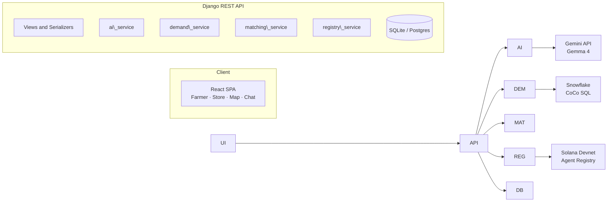

🥬 FoodMatch: Urban Food Desert Supply Chain Matchmaker
> AI-assisted marketplace that connects urban farms and community gardens with corner stores in food deserts, with verifiable onchain trust.


Built for Hacktoberfest 2026 Hack Day, Challenge 3.
---
Table of Contents
The Problem
Our Solution
Sponsor Tracks at a Glance
Architecture
Tech Stack
Gemma 4 Integration (Gemini API)
Snowflake and CoCo
Solana Agent Registry
GitHub Copilot Usage
Getting Started
Environment Variables
API Reference
Project Structure
Testing
Deployment
Demo Script
Contributing
License
---
The Problem
In low-income urban food deserts, corner stores want to sell fresh fruit and vegetables, but commercial suppliers skip them because order volumes are small. At the same time, community gardens and urban farms throw away large amounts of surplus produce because they have no sales channel and no spare hours to find nearby buyers.
Our Solution
FoodMatch closes that gap with four ideas:
AI listings: a farmer uploads a photo; the model checks quality, grades it, and writes the listing automatically.
Demand prediction: Snowflake data shows which neighborhoods face the biggest fresh food deficit on which days of the week.
Smart matching: listings are ranked against stores by neighborhood deficit and distance.
Trust layer: buyer and seller agents have onchain identities on Solana, and every completed deal updates a portable reputation score.
Sponsor Tracks at a Glance
Track	How we use it	Where to look
Google Gemma 4	Produce image analysis, auto descriptions, conversational price bargaining	`backend/market/services/ai\_service.py`
Snowflake CoCo	SQL for predicting weekly fresh food deficit per neighborhood	`sql/`, `backend/market/services/demand\_service.py`
Solana Agent Registry	Agent identity and onchain reputation and feedback	`backend/market/services/registry\_service.py`
GitHub Copilot	Boilerplate, mock data, routing helpers, debugging	Copilot section
Architecture

Core flow
Farmer uploads a produce photo.
Gemma 4 analyzes it and returns a structured listing (item, grade, description, suggested price).
The listing is saved under the farmer's verified agent identity.
The demand service scores nearby neighborhoods using Snowflake data.
The matching service ranks stores by deficit and distance.
Buyer and seller agents negotiate in chat.
On acceptance, feedback is recorded on Solana and the trust badge updates.
Tech Stack
Layer	Technology
Frontend	React, Vite, Tailwind CSS, React Router, Axios, Leaflet
Backend	Python 3.12, Django, Django REST Framework
AI	Gemma 4 through the Gemini API (`google-genai`)
Data	Snowflake, SQLite (dev) / Postgres (prod)
Blockchain	Solana devnet, Agent Registry
DevOps	Docker, docker-compose, nginx, AWS EC2
Gemma 4 Integration (Gemini API)
Gemma 4 is called through the Gemini API using the `google-genai` SDK. The exact model ID is read from the `GEMMA\_MODEL\_ID` environment variable.
Model used: `<FILL IN: exact Gemma 4 model ID>`
Image analysis: produce photo in, strict JSON out (`item`, `grade`, `freshness\_notes`, `description`, `suggested\_price\_per\_kg`). Output is validated before it is saved.
Negotiation agent: the seller agent replies to buyer offers with a floor price guardrail.
Code location: `backend/market/services/ai\_service.py`
Sample request flow
```
Photo upload → ai\_service.analyze\_produce() → Gemini API (Gemma 4)
            → JSON validation → Listing saved → Response to UI
```
> 📸 Add a screenshot of the AI result card here: `docs/screenshots/ai-result.png`
Snowflake and CoCo
We use a free dataset from the Snowflake Marketplace to estimate the fresh food deficit per neighborhood and per day of the week.
Dataset: `<FILL IN: dataset name and provider>`
SQL: `sql/demand.sql`, written with the help of CoCo
Service: `backend/market/services/demand\_service.py` runs the query and returns `\[{day, score}]`. A cached fallback keeps the demo working if Snowflake is unreachable.
CoCo prompts used
```
<FILL IN: the exact prompt(s) you gave CoCo>
```
> 📸 Add a screenshot of CoCo and the query result here: `docs/screenshots/coco.png`
Solana Agent Registry
Every buyer agent and seller agent has a verifiable onchain identity. After each accepted deal, feedback is submitted so reputation is portable across the marketplace.
All Solana logic lives in one adapter, `registry\_service.py`, with three functions: `register\_agent`, `submit\_feedback`, `get\_reputation`.
Agent	Role	Address	Registration tx
`<name>`	Seller	`<address>`	`<signature>`
`<name>`	Buyer	`<address>`	`<signature>`
Feedback transaction example: `<FILL IN: signature link>`
GitHub Copilot Usage
Document where Copilot helped. Judges look for specific prompts and concrete outcomes.
#	Blocker or task	Exact Copilot prompt	Result
1	`<e.g. spatial route boilerplate>`	`<paste prompt>`	`<what it produced / what you changed>`
2	`<e.g. mock inventory data>`	`<paste prompt>`	`<result>`
3	`<e.g. debugging an error>`	`<paste prompt>`	`<result>`
> 📸 Add screenshots or chat logs here: `docs/screenshots/copilot-\*.png`
Getting Started
Prerequisites
Python 3.12+
Node.js 20+
Docker and docker-compose (optional but recommended)
Accounts: Google AI Studio (Gemini API key), Snowflake, a funded Solana devnet wallet
Option A: Docker
```bash
git clone https://github.com/<your-username>/foodmatch.git
cd foodmatch
cp .env.example .env        # then fill in your keys
docker compose up --build
```
Frontend: http://localhost:5173
API: http://localhost:8000/api
Option B: Local development
Backend
```bash
cd backend
python -m venv venv
source venv/bin/activate          # Windows: venv\\Scripts\\activate
pip install -r requirements.txt
cp ../.env.example ../.env        # fill in your keys
python manage.py migrate
python manage.py seed\_demo        # creates demo farmers, stores, listings
python manage.py runserver
```
Frontend
```bash
cd frontend
npm install
npm run dev
```
Environment Variables
Copy `.env.example` to `.env` and fill in the values. Never commit `.env`.
Variable	Description
`DJANGO\_SECRET\_KEY`	Django secret key
`DEBUG`	`True` for development, `False` in production
`ALLOWED\_HOSTS`	Comma-separated hosts
`CORS\_ALLOWED\_ORIGINS`	Frontend origin(s)
`GEMINI\_API\_KEY`	Google AI Studio API key
`GEMMA\_MODEL\_ID`	Exact Gemma 4 model ID
`SF\_ACCOUNT`, `SF\_USER`, `SF\_PASSWORD`, `SF\_WAREHOUSE`, `SF\_DATABASE`, `SF\_SCHEMA`	Snowflake connection
`SOLANA\_RPC\_URL`	Solana RPC (devnet)
`SOLANA\_PAYER\_KEYPAIR`	Funded devnet wallet key
`SOLANA\_REGISTRY\_PROGRAM\_ID`	Agent Registry program ID
`MATCH\_WEIGHT\_DEFICIT`, `MATCH\_WEIGHT\_DISTANCE`	Matching score weights
API Reference
Base path: `/api`
Method	Endpoint	Description
`POST`	`/listings/`	Upload photo and quantity; returns AI-generated listing
`GET`	`/listings/`	List all listings
`GET`	`/demand/?zip=`	Weekly deficit scores for a ZIP code
`GET`	`/matches/<listing\_id>/`	Ranked stores for a listing
`POST`	`/chat/<deal\_id>/`	Send a message; returns the seller agent reply
`POST`	`/deals/<id>/accept/`	Accept a deal; returns the feedback transaction
`POST`	`/agents/register/`	Register an agent onchain
`GET`	`/health/`	Health check
Project Structure
```
foodmatch/
├── backend/
│   ├── core/                  # Django project settings
│   ├── market/
│   │   ├── models.py          # Agent, Listing, Deal, ChatMessage
│   │   ├── serializers.py
│   │   ├── views.py
│   │   └── services/
│   │       ├── ai\_service.py
│   │       ├── demand\_service.py
│   │       ├── matching\_service.py
│   │       └── registry\_service.py
│   ├── requirements.txt
│   └── manage.py
├── frontend/
│   └── src/
│       ├── pages/             # FarmerUpload, StoreDashboard, MapView, Chat
│       ├── components/        # TrustBadge, ...
│       └── api.js
├── sql/                       # Snowflake / CoCo queries
├── docs/                      # Screenshots and extra docs
├── docker-compose.yml
├── .env.example
├── LICENSE
└── README.md
```
Testing
```bash
cd backend
pytest
```
Tests cover the matching logic, the AI response parser, and the API endpoints. External services (Gemini, Snowflake, Solana) are mocked.
Deployment
The target is a single AWS EC2 instance running docker-compose, with nginx serving the React build and proxying `/api` to Django (gunicorn). See `DEPLOY.md` for step by step instructions.
Demo Script
About 3 minutes:
Farmer uploads a produce photo and the AI grades it and writes the listing.
Open the store dashboard and show the weekly deficit chart.
Show the matched listings and the map.
Negotiate the price in chat.
Accept the deal and open the Solana Explorer link to show the onchain feedback.
> 🎥 Demo video: `<FILL IN: link>`
> 🌐 Live demo: `<FILL IN: link>`
Contributing
Contributions are welcome.
Fork the repo
Create a branch: `git checkout -b feature/your-feature`
Commit your changes with a clear message
Open a pull request
License
Released under the MIT License.
